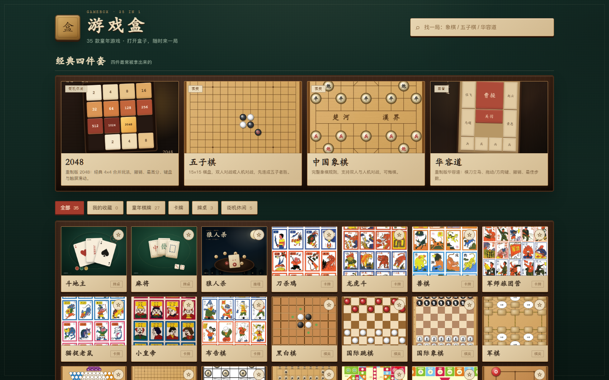
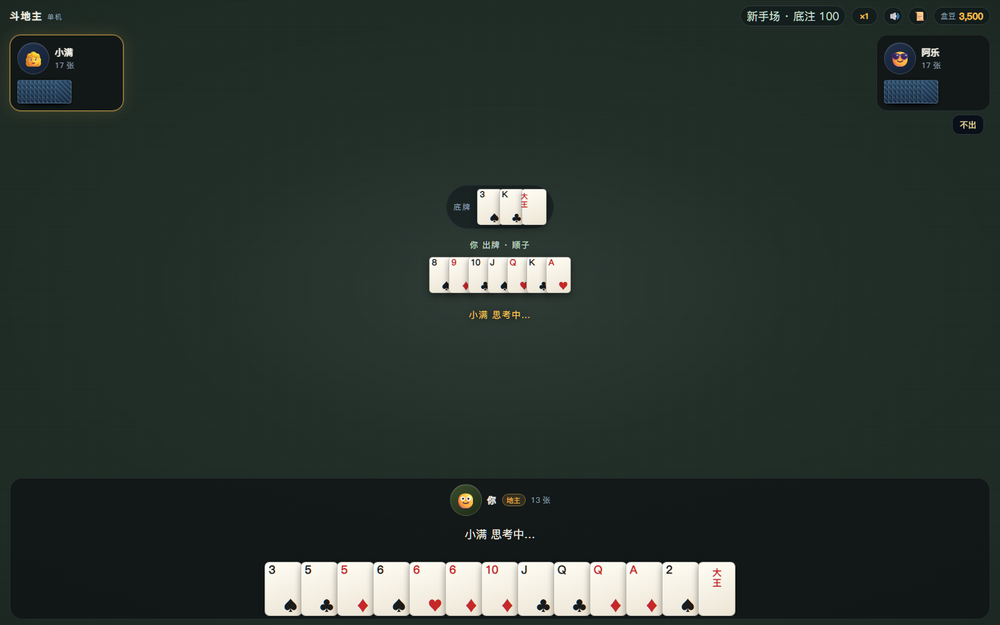
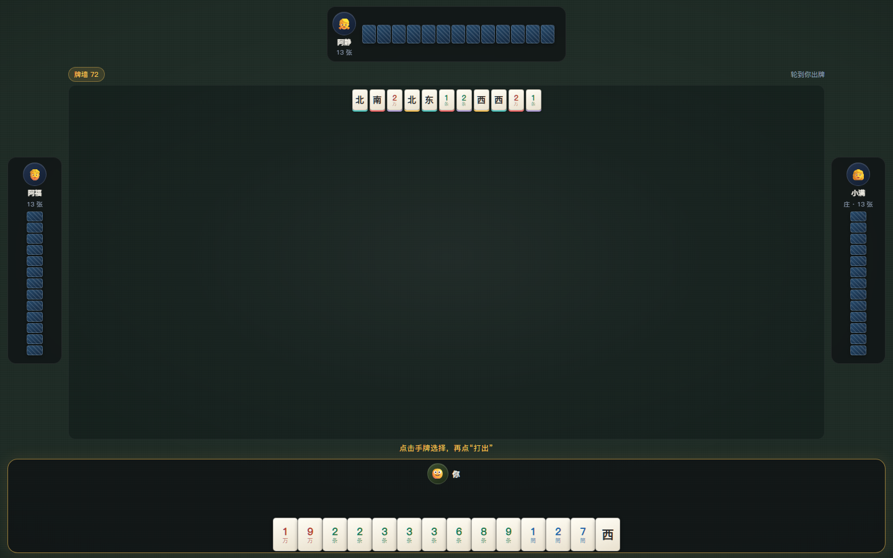
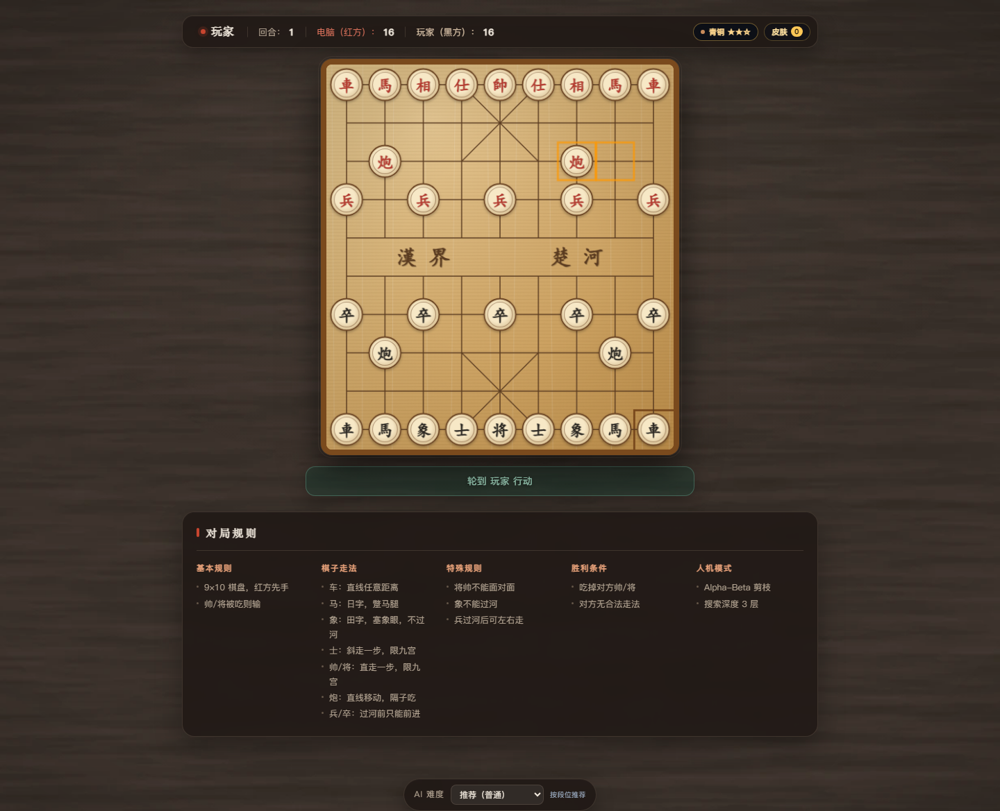
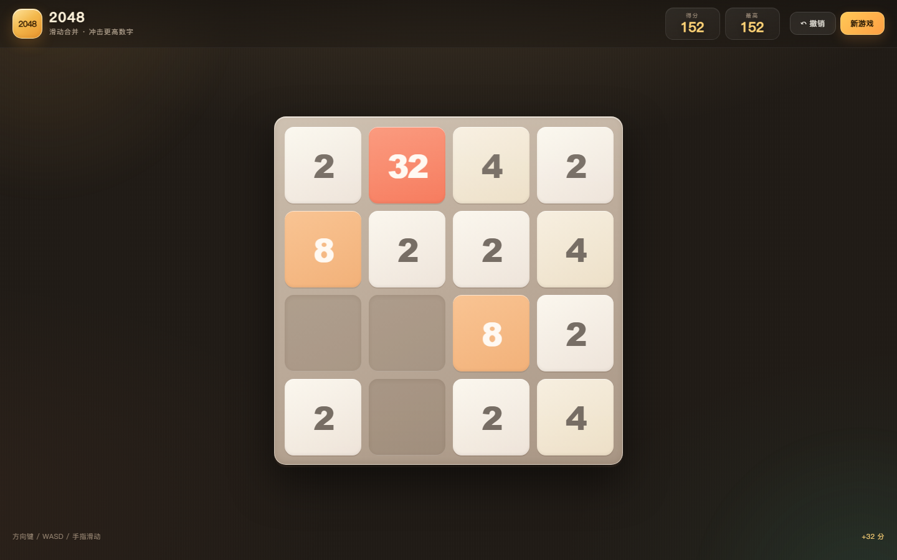
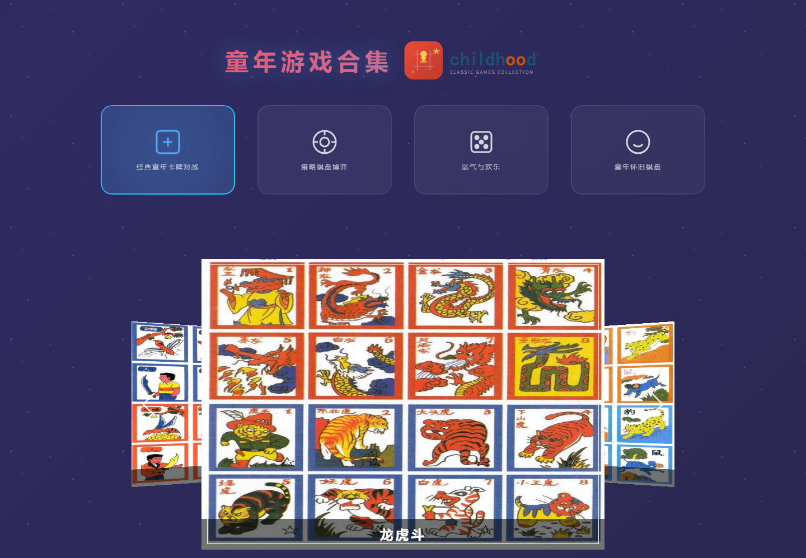
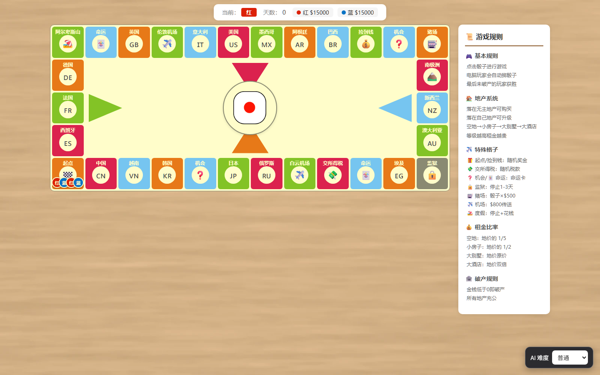

<p align="center">
  
</p>

<h1 align="center">游戏盒 GameBox</h1>

---

<p align="center"><strong>35 款经典小游戏，打开即玩。</strong></p>

<p align="center">狼人杀 · 童年合集 · 2048 · 斗地主 · 麻将 · 中国象棋 · 飞行棋 · 大富翁</p>

<p align="center">
  
  
  
  
  
  
</p>

<p align="center"><strong>简体中文</strong> ｜ <a href="README.en.md">English</a></p>

---

## 这是什么

游戏盒把 **童年游戏合集（childhood）** 和 **游戏盒重制的单机小游戏** 合并到一个应用里，并打包为 Windows EXE 与 Android APK。所有游戏均为单机，进入默认人机对战，不需要联网。

## 截图

| 游戏盒首页 | 狼人杀 |
|:---:|:---:|
|  |  |

| 斗地主 | 麻将 |
|:---:|:---:|
|  |  |

| 中国象棋 | 2048 |
|:---:|:---:|
|  |  |

| 童年游戏合集 | 大富翁 |
|:---:|:---:|
|  |  |

## 成品

| 平台 | 文件 | 说明 |
|---|---|---|
| Windows | `GameBox-1.9.1.exe` | 便携版，双击即用，无需安装（未签名，SmartScreen 可能提示） |
| Android | `GameBox.apk` | debug 签名，可直接安装（需允许未知来源） |

> 源码仓库不包含 `node_modules`、`release` 构建产物和 `_src` 参考源；成品请按下方“构建”步骤生成，或到 Releases 下载。

## 验证情况

- 已在 Chromium 中实测：首页 35 款游戏渲染正常，2048 / 五子棋 / 华容道 / 蜘蛛纸牌 / 消消乐 / 狼人杀可进入、可退出，无控制台报错。
- 2048：重制为纯前端 4×4 版本；实测合并、得分、最高分、撤销、键盘方向键、触屏滑动、达成 2048、棋盘填满结算。
- 消消乐：替换原连连看；实测相邻点击 / 滑动交换、三连消除、下落补充、连锁、连击、步数与目标、提示、洗牌、无解自动洗牌、过关 / 失败结算、下一关与难度切换。AI 自动试玩 8 步后无残留匹配、无空格、64 块完整。
- 斗地主：300 局纯 AI 对战无非法牌型、无卡死；嵌入游戏盒后实测叫地主、提示、出牌、不出、退出正常。
- 麻将：50 局 AI 模拟无卡死（40 胜 10 流局）；实测碰、杠、吃、点炮胡、自摸胡、再来一局正常。
- 扫雷：实测初级 / 中级 / 高级三种难度、首击安全、洪水展开、右键插旗、错误旗标记、胜利与踩雷结算、最佳成绩记录。
- 蜘蛛纸牌：实测单 / 双 / 四花色、发牌、同花色降序移动、K→A 自动收组、撤销、提示、通关结算。
- 华容道：实测横刀立马布局、拖动 / 方向键移动、碰撞限制、撤销、重开、通关结算与最佳步数。
- 军棋：修复进入后模式菜单被隐藏、但人机按钮未被点击导致的白屏；现可直接进入明棋人机，棋盘 50 枚棋子正常渲染。
- 大富翁：修复骰子结束后总显示 1 点的问题，最终点数与实际移动步数一致；事件、买地、升级、赌场和结算提示都会写明实际行动方（如“蓝方”）；手机 / 平板改用纵向布局，棋盘按屏幕宽度缩放，规则面板移到棋盘下方。
- 飞行棋：修复电脑连续掷到 6 时，第二次额外掷骰被提前触发、导致回合卡死的问题；现在连续两个 6 会正常连续行动，连续三个 6 会收回所有飞机并轮到下一家；落地终点也能正确计为完成。
- 斗地主：修复未叫到地主的玩家也显示“地主”标识的问题，现在只有实际叫到地主的玩家显示该标识。
- 斗地主：新增单机盒豆系统，提供新手 / 标准 / 高手三档场次；炸弹、王炸、春天会提高结算倍数；每日登录、每日首胜和破产补助保证单机模式始终有局可玩。盒豆只保存在本地，不能充值或兑换。
- 斗地主盒豆：实测初始 3,000 + 每日 500；新手 / 标准 / 高手场入场限制与解锁；炸弹、王炸、春天 / 反春倍率；地主 ×2、农民 ×1 结算；每日首胜、破产补助、再来一局与换场正常。
- 斗地主 1.8.0：新增 8 位 AI 对手（小满、阿福、阿乐、小北、老K、糖糖、阿七、竹姐）与盒豆小铺。每局随机抽取 2 位、不重复、避免连续同一组合；AI 从 1,500–1,800 盒豆起步，只购买头像框 / 称号，保留 500 底金，不影响出牌、难度和玩家盒豆。
- 斗地主小铺：4 款牌桌（含默认）、4 款牌背（含默认）、5 款头像框、6 款称号；永久拥有、固定价格、无随机、无属性加成；购买和装备后保留 1,000 盒豆底金，入口在顶栏盒豆、结算页和场次页。
- 斗地主 1.8.0 实测：小铺兑换 / 装备 / 持久化、1,000 底金拦截、顶栏 / 结算 / 场次入口、AI 资料卡、AI 购买动态、300 次随机对手抽取无重复 / 无连续同组、300 局 AI 模拟无卡死。
- 背景体系：牌桌类保持 `#1e2b25` 深墨绿哑光毡布；棋类改为中度深暖棕灰的柔和乌木木纹；大富翁 / 飞行棋改为浅暖棕木纹桌面。所有木纹均为低对比、无密集竖条纹、无全局高光、无明显暗角。
- 进入游戏加速：跳过猜拳结果的 1.5 秒等待，常见游戏约 0.2～0.8 秒进入；较慢的游戏会显示“正在进入…”过渡提示。
- 童年游戏：实测国际跳棋 / 五子棋 / 刀杀鸡进入后自动人机、跳过模式菜单与猜拳；中国跳棋 / 飞行棋自动本地开局（玩家 vs 电脑）；右上角图标与“首页”按钮已移除。
- 童年游戏 1.8.1：移除猜拳被自动跳过时的胜利 / 失败 / 平局音效；正常对局结束的胜利 / 失败 / 平局音效保留。
- 狼人杀 1.9.1：6 人 / 9 人单机局，含预言家、女巫、猎人、遗言、观战与局后复盘；浏览器实测完整跑通“起跳 → 放逐 → 遗言”流程，控制台 0 报错，移动端 390×844 无横向溢出。
- 狼人杀发言：纯本地规则生成，不依赖任何模型或网络；分场景控制篇幅（跳身份 16–50 字、追问 22–54、过 34–62、指控 44–80、保人 42–78、反驳 56–96），实测各 300 局平均 50.0 / 51.4 字，同局逐字重复 0%，跨局约 9–10%。
- 狼人杀平衡：各 6,000 局模拟，6 人局好人胜率 47.8%、9 人局 39.2%。
- Windows 便携版已实际启动，窗口标题与首页加载正常。
- APK 已成功编译，包名 `com.gamebox.app`，应用名“游戏盒”，targetSdk 34，支持横竖屏。
- 当前电脑未连接 Android 设备，APK 未做真机安装测试；如遇问题请告诉我具体机型与现象。

## 包含的游戏（35 款）

所有游戏均为单机，进入默认人机对战，不需要联网。

**经典四件套**：2048、五子棋、中国象棋、华容道

**牌桌（3 款，游戏盒自研纯前端单机版）**

- 斗地主：你 vs 两个 AI，盒豆场次、叫地主、炸弹、王炸、提示、再来一局
- 麻将：推倒胡，你 vs 三个 AI，支持吃、碰、杠、胡，牌墙流局
- 狼人杀：6 人 / 9 人单机局，你 vs 五个或八个规则 AI；发言、查验、用药、投票，出局后观战并支持局后复盘

**童年棋牌（27 款）**

- 卡牌：刀杀鸡、龙虎斗、兽棋、军师旅团营、猫捉老鼠、小皇帝、布告棋
- 棋盘：黑白棋、五子棋、国际跳棋、中国象棋、国际象棋、军棋、中国跳棋、围棋、斗兽棋、将棋
- 骰子：飞行棋、大富翁
- 怀旧：井字棋、狼吃羊、憋茅坑、小猫钓鱼、钻牛角尖、摆四龙、蚂蚁搬家、四步钉

**街机休闲（5 款，游戏盒重制）**

- 2048：经典 4×4，撤销、最高分、键盘与触屏滑动
- 消消乐：相邻交换三连消除，连锁、连击、关卡目标与星级
- 华容道：拖动 / 方向键、撤销、最佳步数
- 蜘蛛纸牌：单 / 双 / 四花色、撤销、提示
- 扫雷：三种难度、首击安全、插旗、和弦展开

## 目录结构

```
GameBox/
├─ app/                  # 合并后的前端（Capacitor 的 webDir）
│  ├─ index.html         # 游戏盒首页
│  ├─ hub.css / hub.js   # 首页与播放器
│  ├─ games.js           # 35 款游戏清单
│  ├─ covers/            # 游戏封面
│  ├─ shared/            # 公共音效等
│  ├─ games/
│  │  ├─ werewolf/       # 狼人杀（6 / 9 人单机版）
│  │  ├─ ddz/            # 斗地主（单机版）
│  │  ├─ mahjong/        # 麻将（单机推倒胡）
│  │  ├─ g2048/          # 2048（重制版）
│  │  ├─ linklink/       # 消消乐（原连连看入口）
│  │  ├─ minesweeper/    # 扫雷（重制版）
│  │  ├─ spider/         # 蜘蛛纸牌（重制版）
│  │  └─ klotski/        # 华容道（重制版）
│  └─ childhood/         # 童年游戏合集静态资源
│     ├─ images/bg/      # 棋类深木纹 / 大富翁浅木纹背景
│     └─ js/common.js    # 单人模式与背景注入
├─ server.js             # Electron 用的本地静态服务器
├─ electron-main.js      # Electron 入口
├─ capacitor.config.json # Capacitor 配置
├─ android/              # Capacitor 生成的 Android 工程
├─ build/                # 图标
└─ release/              # 打包产物
```

## 本地开发

```bash
# 浏览器调试
node server.js            # 打开 http://127.0.0.1:8899

# Windows 调试
npm start

# 重新打 EXE
npm run dist:win

# 重新打 APK
npx cap sync android
cd android
gradlew.bat assembleDebug
```

## 对原项目做的改动

- 新增统一首页 / 游戏启动器，把两套游戏的入口合并。
- 2048 重制为纯前端 4×4 版本，移除对 XGames 构建产物的依赖；支持撤销、最高分、键盘与触屏。
- 连连看整体替换为消消乐玩法：相邻交换、三连消除、下落补充、连锁、连击、步数目标、关卡与星级。
- 新增自研的纯前端单机斗地主与麻将（吃碰杠胡、AI 对战），不依赖服务端。
- 新增自研单机狼人杀：6 / 9 人局、预言家 / 女巫 / 猎人技能、遗言与观战、局后复盘；AI 发言由本地 `speech.js` 组装，含场景化篇幅控制与两级去重，完全离线。
- 童年游戏默认人机：隐藏双人/联网按钮与模式选择，自动跳过猜拳；移除右上角 GitHub / 反馈 / QQ / 收藏图标和“首页”按钮。
- 修复军棋等使用 `data-opp-type="pve"` 的页面无法自动开局的问题；顺带兼容文字为“人机”的模式按钮。
- 修复狼吃羊 / 蚂蚁搬家 / 摆四龙 / 四步钉等游戏因猜拳按钮结构不同而卡在空白页的问题。
- 扫雷、蜘蛛纸牌、华容道重制为纯前端版本，统一游戏盒主题并适配手机触屏。
- 棋类背景改为中度深暖棕灰的柔和乌木木纹；大富翁 / 飞行棋改为浅暖棕木纹桌面；牌桌类保持深墨绿哑光毡布。
- 大富翁 / 飞行棋的 jQuery 改为本地文件，骰子滚动改为自研轻量组件；移除百度统计脚本，离线运行时不再请求 CDN 或统计服务。
- 修复大富翁骰子最终点数、行动方提示文案和手机 / 平板棋盘布局；窄屏规则面板改为棋盘下方。
- 移除不再使用的 XGames 构建目录（约 3 MB），减小安装包体积。

## 已知限制

1. **童年合集中的服务端版斗地主、麻将、五子棋/中国象棋没有包含**：它们依赖 Go + WebSocket 服务端和 SQLite，无法在纯前端 APK 中运行。游戏盒内置了自研的离线斗地主与麻将（简化 AI，非比赛级），五子棋与中国象棋使用 childhood 的纯前端版本。
2. 斗地主与麻将为简化规则版本：不含癞子、加倍、抢地主、番数计算、抢杠胡等进阶规则；AI 为轻量启发式，强度适合休闲。
3. APK 使用 debug 签名，适合自己安装测试；上架应用商店需要自行生成 release keystore 并签名。
4. 消消乐为休闲难度，AI 试玩与人工体验不能替代完整平衡性测试；后续可按实际手感调整目标分与步数。
5. 狼人杀 AI 发言为本地规则模板 + 随机组合，不是语言模型，偶尔仍会出现相似句式；跨局逐字重复约 9–10%，集中在“我先不收票”这类短句，以及报身份这类信息固定的句子。
6. 狼人杀目前只有 6 人与 9 人两种人数配置，没有警长、白狼王等扩展角色。

## 来源与许可

- [AloysHF/childhood](https://github.com/AloysHF/childhood) — Apache License 2.0
- 2048 为经典玩法的独立重制版；早期版本曾参考 [xthuji/xgames](https://github.com/xthuji/xgames)（MIT），该构建自 1.7.0 起已不再随包分发。
- jQuery 4.0.0（MIT License）用于大富翁 / 飞行棋的本地交互逻辑。
- GameBox 本身以 MIT License 发布。
